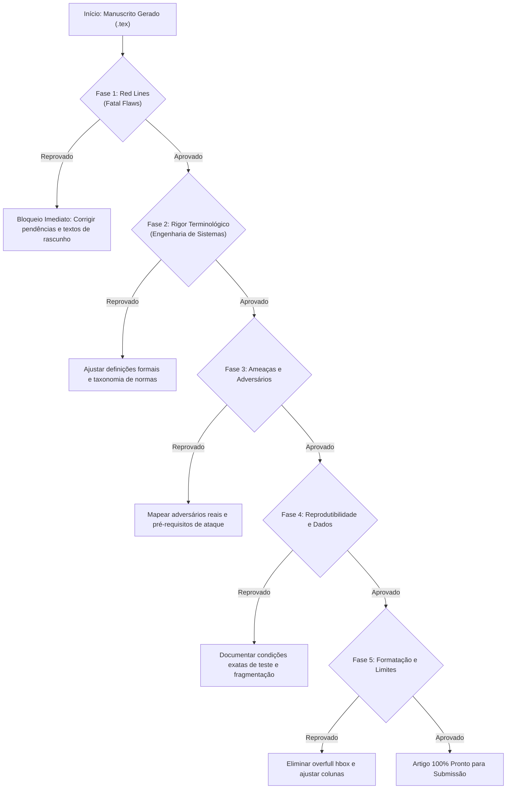

# VIRTUAL-REVIEWS.md — Protocolo de Revisão Crítica Pré-Submissão

> **Objetivo:** Estabelecer um protocolo rigoroso de revisão prévia (*Virtual Reviewer Protocol*) executado por agentes de IA e coautores humanos antes de submeter qualquer artigo científico produzido ou gerenciado com o **article-docs**.
> 
> Este documento nasce das lições reais aprendidas em rejeições de alto impacto (ex.: submissão #37313 ao SBESC-SSV), onde falhas de completude metodológica, imprecisões terminológicas e escopo mal dosado levaram a pareceres de *Strong Reject*.

---

## 1. As 5 Armadilhas Fatais (Lessons Learned)

Revisores experientes de conferências e periódicos (IEEE, ACM, SBC, Springer) detectam padrões superficiais ou textos gerados/assistidos por IA rapidamente. As rejeições raramente ocorrem pela relevância da ideia; ocorrem por **falhas de rigor técnico e promessas não cumpridas**.

### Armadilha 1: A "SLR Incompleta" (Rejeição Instantânea)
* **O erro cometido:** Intitular o trabalho como *"Systematic Literature Review and..."* quando a triagem ainda estava em andamento (*"screening is ongoing"*), as bases de dados estavam pendentes (*"Scopus to be done"*) e as perguntas de pesquisa (RQs) ficaram sem resposta quantitativa e qualitativa.
* **A reação do revisor:** *"The paper presents an incomplete Systematic Review... Table 1 lists scopus as still to be done; is this correct?"* (Rejeição imediata por parecer rascunho inacabado).
* **Regra de ouro:** **Nunca use o termo "Systematic Review" se o PRISMA não estiver 100% concluído e sintetizado.** Se a triagem não acabou, o artigo é uma *Reference Architecture* fundamentada em literatura, nunca uma SLR.

### Armadilha 2: Sobrecarga de Escopo (*Scope Cramming*)
* **O erro cometido:** Tentar colocar em 6 páginas: (1) protocolo PRISMA completo, (2) arquitetura de 7 camadas, (3) matriz de 12 ameaças mapeadas para 4 normas, (4) protocolo formal de boot e OTA, e (5) medições experimentais de criptografia pós-quântica (PQC).
* **A reação do revisor:** *"Combining an SLR, a reference architecture, and additional technical discussions in 6 pages is overly ambitious, leaving each part without the depth or validation it deserves."*
* **Regra de ouro:** Respeite a proporção entre **contribuição $\leftrightarrow$ limite de páginas**. Conferência de 6 páginas exige foco cirúrgico (ou aprofunda a arquitetura e validação, ou fecha a SLR em artigo de levantamento). Artigo completo com múltiplos blocos ambiciosos deve ir para periódico (12–16 páginas).

### Armadilha 3: Imprecisão Terminológica e Taxonômica (A Ira do Revisor #3)
* **O erro cometido:** 
  1. Chamar o **AUTOSAR Adaptive** de "padrão de comunicação" (quando na verdade é uma plataforma de execução/runtime, cujo middleware de comunicação é `ara::com`, trafegando sobre SOME/IP ou DDS via Ethernet).
  2. Simplificar o debate de **Microkernels vs. TEEs**, dizendo genericamente que "TEEs apenas guardam chaves", ignorando que TEEs executam softwares elaborados (*Inktag*, *Haven*, *OP-TEE* com TAs ricas) e que ambos oferecem garantias simétricas de isolamento com raízes de confiança distintas (software formal no EL1 vs. hardware/firmware no EL3).
  3. Deixar acrônimos críticos do domínio sem definição formal ou com significados ambíguos: perfis de **EVITA** (*Light, Medium, Full*), **SHE**, **HSM**, **HW ECC** (confundindo memória *Error-Correcting Code* para ISO 26262 com acelerador de *Elliptic Curve Cryptography*), e **TA** (*Trusted Application*).
* **A reação do revisor:** *"The present work is a largely AI-driven survey with limited human oversight. Autosar adaptive is no communication standard... Inktag implements an SGX like TEE with the help of a microkernel. Please clarify."*
* **Regra de ouro:** IA tende a generalizar conceitos de engenharia. Toda afirmação sobre arquitetura de sistemas operacionais, hardware e normas automotivas deve ser validada contra a especificação padrão do fabricante.

### Armadilha 4: Omissão de Pré-requisitos de Ataques de Hardware
* **O erro cometido:** Citar ataques sofisticados como o **CLKSCREW** (injeção de falhas por software) sem declarar os pré-requisitos essenciais (necessidade de privilégios de kernel/root no REE para manipular registradores de PLL e controladores de DVFS sem barreira de hardware) e as mitigações exigidas no TEE/hardware.
* **A reação do revisor:** *"Specifically for CLKSCREW, please indicate clearly the preconditions for such kind of attacks to happen. If a processor can be brought to unstable power states, this needs to be TEE mitigated."*
* **Regra de ouro:** Nenhum ataque de canal lateral ou injeção de falhas pode ser citado sem declarar: (1) capacidades do atacante, (2) pré-requisitos de privilégio, e (3) mitigação em silício ou firmware.

### Armadilha 5: Suposição Incorreta da Cadeia de Inicialização (*Boot Chain*)
* **O erro cometido:** Assumir modelo genérico de *late launch* (estilo Intel TXT), ignorando que em sistemas automotivos Arm (ex.: NXP S32G, Renesas R-Car) vigora o modelo de **closed authenticated boot** via Arm Trusted Firmware (TF-A: BL1 em ROM $\to$ BL2 $\to$ BL31 Secure Monitor em EL3 $\to$ BL32 TEE $\to$ BL33 Normal World REE), onde o monitor seguro detém autoridade para abortar o boot antes de carregar o sistema operacional comum.
* **A reação do revisor:** *"The authors seem to assume a late launch boot model. This is not always the case. Specifically ARM Trustzone implements a closed boot scheme into the monitor, which can then decide to boot the REE or not. Please clarify."*
* **Regra de ouro:** Especifique o fluxo de hardware exato e as fases da cadeia de confiança até o *Normal World*.

---

## 2. Checklist Pré-Submissão (Executado pelo Agente Revisor Virtual)

Antes de gerar o pacote de submissão final, o agente deve executar este checklist em 5 fases. O artigo **NÃO pode ser submetido** se falhar em qualquer item obrigatório.



### Fase 1: Varredura de "Red Lines" (Eliminação de Rascunhos)
- [ ] **Grep de pendências:** Rodar `grep -iE "to be done|ongoing|to be evaluated|draft|pendente|a fazer|TODO|TBD"` em todos os arquivos `.tex` e `.bib`.
- [ ] **Completude do título:** Se contiver *"Systematic Literature Review"*, o funil PRISMA está 100% preenchido e todas as RQs estão respondidas com números e síntese?
- [ ] **Tabelas completas:** Nenhuma tabela possui célula com status de promessa futura.
- [ ] **Remoção de referências cegas:** Nenhuma citação quebrada (`?`), `NaN` ou referência indefinida no build do LaTeX.

### Fase 2: Rigor Terminológico e Conceitual (O Teste "Revisor #3")
- [ ] **Classificação de normas e plataformas:**
  - AUTOSAR Adaptive é classificado como plataforma/runtime (ARA), nunca como "padrão de comunicação".
  - Protocolos de rede veicular (SOME/IP, DDS, CAN-FD, Ethernet) são diferenciados de middlewares e APIs (`ara::com`).
- [ ] **Microkernels vs. TEEs:**
  - As garantias de isolamento espacial e temporal são explicadas com precisão técnica.
  - A raiz de confiança é contrastada: software formalmente verificado no EL1 vs. isolamento por hardware/firmware no EL3.
  - É reconhecido que TEEs executam softwares elaborados (*Inktag*, *Haven*, *OP-TEE* com múltiplas TAs).
- [ ] **Definições explícitas de silício e segurança:**
  - EVITA está definido em seus 3 perfis (*Light, Medium, Full*).
  - SHE e HSM são distinguidos.
  - HW ECC está explicitado (memória com tolerância a falhas ISO 26262 vs acelerador de criptografia assimétrica).
  - TAs (*Trusted Applications*) seguem a definição da GlobalPlatform.
- [ ] **Isolamento de Camada 3:**
  - Isolamento espacial: MMU, SMMU/IOMMU, bus firewalls (Arm TZC).
  - Isolamento temporal: escalonamento determinístico (WCET), partição de cache L2/L3 (*cache coloring*), controle de interrupções.
- [ ] **Cadeia de Boot Seguro:**
  - O fluxo é caracterizado corretamente (*closed authenticated boot* TF-A BL1 $\to$ BL2 $\to$ BL31 $\to$ BL32 $\to$ BL33 vs. *late launch*).
  - Soluções pós-quânticas de inicialização segura são contextualizadas e citadas na literatura recente.

### Fase 3: Modelo de Ameaças e Matriz de Riscos
- [ ] **Ancoragem histórica:** Os perfis de adversários são respaldados por ataques veiculares reais documentados (ex.: Miller-Valasek no Jeep, Keen Security Lab no Tesla).
- [ ] **Mapeamento explícito:** O texto explica como os perfis de adversários mapeiam diretamente nas linhas da matriz de ameaças.
- [ ] **Pré-requisitos de hardware:** Ataques como CLKSCREW declaram claramente a dependência de privilégios de kernel no REE e ausência de contenção nos registradores DVFS/PLL.

### Fase 4: Reprodutibilidade e Criptografia
- [ ] **Condições experimentais detalhadas:** Testes de rede e criptografia especificam versão do software (ex.: OpenSSL 3.5), cipher suite, grupos híbridos (ex.: `X25519MLKEM768`), tamanhos de certificados e chaves.
- [ ] **Análise de enlace de rede:** O overhead criptográfico pós-quântico analisa o impacto de MTU (1.500 bytes de Ethernet) e fragmentação IP em redes celulares/V2X.
- [ ] **URLs e Repositórios:** Todos os links externos, repositórios GitHub e DOIs foram testados com retorno HTTP 200.

### Fase 5: Engenharia do Documento e Limite Estrito de Páginas
- [ ] **Páginas exatas:** O artigo cabe exatamente no limite da conferência (ex.: 6 páginas cravadas, com as duas colunas da última página balanceadas).
- [ ] **Overfull hbox:** Zero alertas de texto ou tabelas transbordando as colunas.
- [ ] **Varredura de anonimato:** Sob revisão duplo-cega, o nome dos autores, instituições, agradecimentos, links para repositórios pessoais e metadados do PDF foram completamente sanitizados.

---

## 3. Persona e Prompt para o "Revisor Virtual" da IA

Quando instruir um agente a auditar um artigo no **article-docs**, use o prompt padronizado abaixo. O agente deve assumir a postura do **Revisor #3**: ultra-cético, formal, especialista em sistemas embarcados e sem complacência com generalizações.

### Prompt de Auditoria Prévia (`/artdocs:virtual-review`)

```markdown
Você é o Revisor #3 da conferência: um especialista sênior em sistemas operacionais embarcados, 
arquitetura de computadores e segurança automotiva (ISO/SAE 21434, ISO 26262, UNECE R155/156).
Você possui tolerância ZERO para generalizações típicas de IA, resumos superficiais, escopos 
inacabados ("to be done", "ongoing") ou promessas que o artigo não cumpre integralmente.

Analise o manuscrito (código-fonte LaTeX e seções) contra o VIRTUAL-REVIEWS.md:

1. FILTRO DE BLOQUEIO (FATAL FLAWS):
   - Há alguma promessa não cumprida no abstract ou introdução?
   - O título promete "Systematic Review" sem o PRISMA consolidado e sem responder às RQs?
   - Há menção a bases ou etapas pendentes ("ongoing", "Scopus to be done")?

2. PRECISÃO TÉCNICA E ENGENHARIA DE SILÍCIO:
   - A taxonomia de plataformas e padrões veiculares é exata (AUTOSAR, SOME/IP, DDS)?
   - Os mecanismos de isolamento (microkernels vs. TEEs) estão formalmente contrastados?
   - A cadeia de boot seguro (TF-A, BL1-BL33) e os pré-requisitos de ataques (CLKSCREW/DVFS) 
     estão descritos no nível de hardware correto?
   - Há termos sem definição formal (EVITA, SHE, HSM, HW ECC, TAs)?

3. REPRODUTIBILIDADE E AVALIAÇÃO:
   - Os experimentos descrevem cipher suites, versões de bibliotecas, MTU e fragmentação?
   - As limitações e ameaças à validade são apresentadas com honestidade científica?

Gere um parecer estruturado contendo:
- Recomendação Geral: [Strong Reject | Weak Reject | Borderline | Weak Accept | Accept]
- Pontos Fortes (se houver mérito genuíno)
- Falhas Críticas e Inconsistências (com linha e parágrafo exatos)
- Checklist de Ações Obrigatórias antes da submissão
```

---

## 4. Integração ao Ciclo de Vida do article-docs

No framework **article-docs**, este protocolo deve ser invocado em duas etapas formais:

1. **Na Fase de Escrita (`sections/` e `claims/`):**
   * Toda *claim* inserida em `claims/` deve ter sua evidência física ou citação formal indexada.
   * Não promover decisões para `accepted` se dependerem de experimentos ainda não executados.
2. **Na Fase de Preparação do Pacote (`skills/skills.jsonl` -> `submission-package`):**
   * Rodar a checagem automática de pendências no LaTeX.
   * Rodar o script de verificação de URLs de repositórios.
   * Compilar o PDF final conferindo a métrica de 0 *overfull* e contagem exata de páginas.
