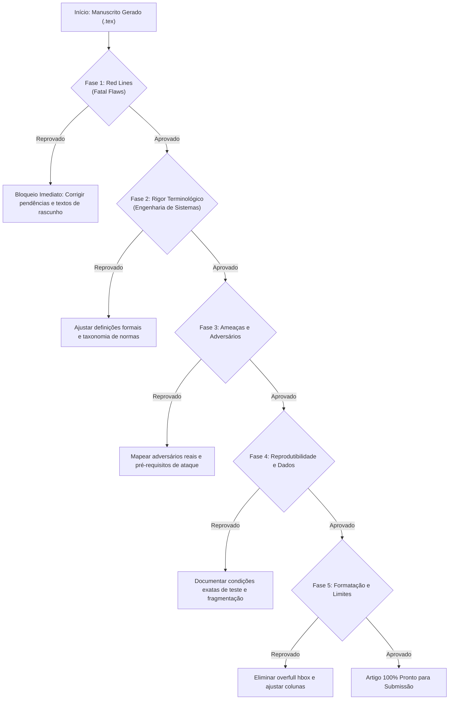

# VIRTUAL-REVIEWS.md — Protocolo de Revisão Crítica Pré-Submissão

> **Objetivo:** Estabelecer um protocolo rigoroso de revisão prévia (*Virtual Reviewer Protocol*) executado por agentes de IA e coautores humanos antes de submeter qualquer artigo científico produzido ou gerenciado com o **article-docs**.
> 
> Este documento nasce das lições reais aprendidas em rejeições de alto impacto em eventos e periódicos (ex.: submissões #37312 e #37313 ao SBESC-SSV), onde falhas de completude metodológica, compilação defeituosa, dependências externas de trabalhos não publicados, imprecisões terminológicas e escopo mal dosado levaram a pareceres de *Reject*.

---

## 1. As 10 Armadilhas Fatais (Lessons Learned)

Revisores experientes de conferências e periódicos (IEEE, ACM, SBC, Springer) detectam padrões superficiais, compilações apressadas ou textos com dependências frágeis rapidamente. As rejeições raramente ocorrem pela relevância da ideia; ocorrem por **falhas de rigor técnico, promessas não cumpridas e problemas formais de compilação**.

### Armadilha 1: A "SLR Incompleta" (Rejeição Instantânea)
* **O erro cometido:** Intitular o trabalho como *"Systematic Literature Review and..."* quando a triagem ainda estava em andamento (*"screening is ongoing"*), as bases de dados estavam pendentes (*"Scopus to be done"*) e as perguntas de pesquisa (RQs) ficaram sem resposta quantitativa e qualitativa.
* **A reação do revisor:** *"The paper presents an incomplete Systematic Review... Table 1 lists scopus as still to be done; is this correct?"* (Rejeição imediata por parecer rascunho inacabado).
* **Regra de ouro:** **Nunca use o termo "Systematic Review" se o PRISMA não estiver 100% concluído e sintetizado.** Se a triagem não acabou, o artigo é uma *Reference Architecture* fundamentada em literatura, nunca uma SLR.

### Armadilha 2: Sobrecarga de Escopo (*Scope Cramming*)
* **O erro cometido:** Tentar colocar em 6 páginas: (1) protocolo PRISMA completo, (2) arquitetura de 7 camadas, (3) matriz de 12 ameaças mapeadas para 4 normas, (4) protocolo formal de boot e OTA, e (5) medições experimentais de criptografia pós-quântica (PQC).
* **A reação do revisor:** *"Combining an SLR, a reference architecture, and additional technical discussions in 6 pages is overly ambitious, leaving each part without the depth or validation it deserves."*
* **Regra de ouro:** Respeite a proporção entre **contribuição $\leftrightarrow$ limite de páginas**. Conferência de 6 páginas exige foco cirúrgico (ou aprofunda a arquitetura e validação, ou fecha a SLR em artigo de levantamento). Artigo completo com múltiplos blocos ambiciosos deve ir para periódico (12–16 páginas).

### Armadilha 3: Imprecisão Terminológica e Taxonômica (A Ira do Revisor #3)
* **O erro cometido:** 
  1. Chamar o **AUTOSAR Adaptive** de "padrão de comunicação" (quando na verdade é uma plataforma de execução/runtime, cujo middleware de comunicação é `ara::com`, trafegando sobre SOME/IP ou DDS via Ethernet).
  2. Simplificar o debate de **Microkernels vs. TEEs**, dizendo genericamente que "TEEs apenas guardam chaves", ignorando que TEEs executam softwares elaborados (*Inktag*, *Haven*, *OP-TEE* com TAs ricas) e que ambos oferecem garantias simétricas de isolamento com raízes de confiança distintas (software formal no EL1 vs. hardware/firmware no EL3).
  3. Deixar acrônimos críticos do domínio sem definição formal ou com significados ambíguos: perfis de **EVITA** (*Light, Medium, Full*), **SHE**, **HSM**, **HW ECC** (confundindo memória *Error-Correcting Code* para ISO 26262 com acelerador de *Elliptic Curve Cryptography*), e **TA** (*Trusted Application*).
* **A reação do revisor:** *"The present work is a largely AI-driven survey with limited human oversight. Autosar adaptive is no communication standard... Inktag implements an SGX like TEE with the help of a microkernel. Please clarify."*
* **Regra de ouro:** IA tende a generalizar conceitos de engenharia. Toda afirmação sobre arquitetura de sistemas operacionais, hardware e normas automotivas deve ser validada contra a especificação padrão do fabricante.

### Armadilha 4: Omissão de Pré-requisitos de Ataques de Hardware
* **O erro cometido:** Citar ataques sofisticados como o **CLKSCREW** (injeção de falhas por software) sem declarar os pré-requisitos essenciais (necessidade de privilégios de kernel/root no REE para manipular registradores de PLL e controladores de DVFS sem barreira de hardware) e as mitigações exigidas no TEE/hardware.
* **A reação do revisor:** *"Specifically for CLKSCREW, please indicate clearly the preconditions for such kind of attacks to happen. If a processor can be brought to unstable power states, this needs to be TEE mitigated."*
* **Regra de ouro:** Nenhum ataque de canal lateral ou injeção de falhas pode ser citado sem declarar: (1) capacidades do atacante, (2) pré-requisitos de privilégio, e (3) mitigação em silício ou firmware.

### Armadilha 5: Suposição Incorreta da Cadeia de Inicialização (*Boot Chain*)
* **O erro cometido:** Assumir modelo genérico de *late launch* (estilo Intel TXT), ignorando que em sistemas automotivos Arm (ex.: NXP S32G, Renesas R-Car) vigora o modelo de **closed authenticated boot** via Arm Trusted Firmware (TF-A: BL1 em ROM $\to$ BL2 $\to$ BL31 Secure Monitor em EL3 $\to$ BL32 TEE $\to$ BL33 Normal World REE), onde o monitor seguro detém autoridade para abortar o boot antes de carregar o sistema operacional comum.
* **A reação do revisor:** *"The authors seem to assume a late launch boot model. This is not always the case. Specifically ARM Trustzone implements a closed boot scheme into the monitor, which can then decide to boot the REE or not. Please clarify."*
* **Regra de ouro:** Especifique o fluxo de hardware exato e as fases da cadeia de confiança até o *Normal World*.

### Armadilha 6: O "Build Quebrado" e Citações Indefinidas `[?]` (O Bloqueador de Artefatos)
* **O erro cometido:** Submeter o PDF sem executar o pipeline completo de BibTeX/LaTeX (muito comum ao exportar às pressas de ferramentas web como Overleaf antes de recompilar o cache ou quando há warnings de bibliografia suprimidos), gerando um documento com citações quebradas `[?]` espalhadas no texto — incluindo a própria referência do repositório público de código/dados (Zenodo/GitHub).
* **A reação do revisor:** *"The main problem is that about ten citations are broken ([?]), including the one for the public code and data. That alone makes the paper unpublishable as-is; it also means I couldn't check the artifact."*
* **Regra de ouro:** **Grep obrigatório no PDF final gerado.** Nunca submeta um PDF sem verificar `pdftotext paper.pdf - | grep -F "[?]"` e auditar o arquivo `.log` para confirmar zero avisos de citações ou referências indefinidas.

### Armadilha 7: A Dependência Externa de Trabalho "In Press" / Inacessível (Artigo Não Autossuficiente)
* **O erro cometido:** Apoiar conceitos-chave, taxonomias centrais (ex.: classes de impacto *user-level*, *fleet-level*, *systemic*), métricas e cenários de ataque em uma publicação anterior dos autores que ainda está marcada como *"In press"* e não está acessível online aos revisores.
* **A reação do revisor:** *"The manuscript relies on concepts and classifications introduced in previous work [1]... However, these concepts are not sufficiently defined in the current paper. Furthermore, the referenced article [1] is not accessible online... the article is not entirely self-contained."*
* **Regra de ouro:** **O artigo deve ser 100% autossuficiente.** Todo conceito, classe de impacto e cenário experimental deve ter sua definição formal e operacional apresentada de forma clara no próprio texto. Trabalhos anteriores podem ser contextualizados, mas o leitor jamais pode depender de um PDF inacessível para entender os termos do artigo.

### Armadilha 8: A Premissa Sintética Oculta e a Superestimação de Baselines (*The Fragile Baseline Trap*)
* **O erro cometido:** Promover no Abstract e na Conclusão que um baseline comum (ex.: *typical access log*) "alcança a mesma precisão do esquema completo a uma fração de 26% do custo", quando esse resultado empírico depende de um artefato conveniente do ambiente sintético (ex.: cada conta ter um IP fixo exclusivo, facilitando a separação) que desmorona no mundo real (NAT, redes celulares, IPs dinâmicos, spoofing de dispositivo) e ignora falhas críticas (ex.: precisão 0.0 em campanhas OTA e ausência total de credenciais).
* **A reação do revisor:** *"The headline result ('access log gets you most of the way at 26% storage') rests on the weakest part of the setup. The paper is honest about this in Sec. VII, but the abstract and conclusion lean on it more than it can carry."*
* **Regra de ouro:** **Equalize o destaque do Abstract com a realidade das ameaças à validade.** Se um baseline tem desempenho inflado por premissas ideais do testbed, o Abstract e a Introdução devem apresentá-lo explicitamente como um *limite superior otimista*, destacando suas falhas catastróficas e demonstrando por que o esquema completo proposto é indispensável.

### Armadilha 9: Vazamento de Metalinguagem e Processo Editorial Interno
* **O erro cometido:** Manter no manuscrito frases que revelam o histórico editorial interno (ex.: *"After the confirmatory runs, in response to review, the access-log profile was added..."*) ou disclaimers informais amadores sobre acesso a normas técnicas (ex.: *"ISO/SAE 21434 is not mapped, because its full text was not available to the authors"*).
* **A reação do revisor:** *" 'After the confirmatory runs, in response to review' (Sec. IV-D): the paper refers to a previous review round of itself. That shouldn't be in the submitted text. 'ISO/SAE 21434 is not mapped, because its full text was not available to the authors' is an odd thing to print. Either drop the sentence or get the standard."*
* **Regra de ouro:** **Varredura rigorosa de metalinguagem.** Respostas a revisores ficam exclusivamente na carta de resposta (*Response to Reviewers*). O manuscrito deve soar perene e definitivo. A ausência de mapeamento para uma norma deve ser justificada por distinção técnica de escopo e domínio, nunca por informalidades circunstanciais de acesso.

### Armadilha 10: O Diagrama de Fluxo Genérico que Devora Orçamento de Espaço
* **O erro cometido:** Consumir de 25 a 30 linhas verticais em um artigo curto ($\le 6$ páginas) com uma figura de caixas óbvias de processo geral (*Prepare $\rightarrow$ Collect $\rightarrow$ Preserve $\rightarrow$ Reconstruct $\rightarrow$ Report*), enquanto faltam linhas preciosas para detalhar o tráfego do testbed, as definições formais e a rotulagem de ground truth.
* **A reação do revisor:** *"Table I and Table II are fine, but Fig. 1 adds little... the text is very dense and hard to follow... important details concerning traffic generation and ground truth are missing."*
* **Regra de ouro:** **Densidade informacional estrita nas figuras.** Se um diagrama apenas repete em caixinhas o que uma frase no texto descreve, remova-o. Use o espaço recuperado para tornar o artigo autossuficiente e detalhar as premissas experimentais e metodológicas.

---

## 2. Checklist Pré-Submissão (Executado pelo Agente Revisor Virtual)

Antes de gerar o pacote de submissão final, o agente deve executar este checklist em 5 fases. O artigo **NÃO pode ser submetido** se falhar em qualquer item obrigatório.



### Fase 1: Varredura de "Red Lines" (Eliminação de Rascunhos e Build Limpo)
- [ ] **Grep de pendências:** Rodar `grep -iE "to be done|ongoing|to be evaluated|draft|pendente|a fazer|TODO|TBD"` em todos os arquivos `.tex` e `.bib`.
- [ ] **Auditoria de citações quebradas (`[?]`):** Rodar `pdftotext <paper.pdf> - | grep -F "[?]"` e verificar que não há nenhuma citação não resolvida no PDF gerado.
- [ ] **Varredura de avisos do compilador:** Inspecionar o `<paper>.log` e assegurar zero ocorrências de `Warning: Citation ... undefined` ou `Reference ... undefined`.
- [ ] **Eliminação de metalinguagem e histórico interno:** Verificar ausência de expressões de bastidores (ex.: `in response to review`, `previous round`, `reviewers pointed out`, `not available to the authors`).
- [ ] **Completude do título:** Se contiver *"Systematic Literature Review"*, o funil PRISMA está 100% preenchido e todas as RQs estão respondidas com números e síntese?
- [ ] **Tabelas completas:** Nenhuma tabela possui célula com status de promessa futura.

### Fase 2: Rigor Terminológico e Conceitual (O Teste "Revisor #3")
- [ ] **Autossuficiência de conceitos:** O artigo não depende de publicações "in press" ou inacessíveis para que o revisor entenda suas definições, taxonomias de impacto ou cenários de teste.
- [ ] **Classificação de normas e plataformas:**
  - AUTOSAR Adaptive é classificado como plataforma/runtime (ARA), nunca como "padrão de comunicação".
  - Protocolos de rede veicular (SOME/IP, DDS, CAN-FD, Ethernet) são diferenciados de middlewares e APIs (`ara::com`).
  - Mapeamento para normas (ex.: UN R155 vs ISO/SAE 21434) delimita claramente os escopos regulatórios e de ciclo de vida.
- [ ] **Microkernels vs. TEEs:**
  - As garantias de isolamento espacial e temporal são explicadas com precisão técnica.
  - A raiz de confiança é contrastada: software formalmente verificado no EL1 vs. isolamento por hardware/firmware no EL3.
  - É reconhecido que TEEs executam softwares elaborados (*Inktag*, *Haven*, *OP-TEE* com múltiplas TAs).
- [ ] **Definições explícitas de silício e segurança:**
  - EVITA está definido em seus 3 perfis (*Light, Medium, Full*).
  - SHE e HSM são distinguidos.
  - HW ECC está explicitado (memória com tolerância a falhas ISO 26262 vs acelerador de criptografia assimétrica).
  - TAs (*Trusted Applications*) seguem a definição da GlobalPlatform.
- [ ] **Isolamento de Camada 3:**
  - Isolamento espacial: MMU, SMMU/IOMMU, bus firewalls (Arm TZC).
  - Isolamento temporal: escalonamento determinístico (WCET), partição de cache L2/L3 (*cache coloring*), controle de interrupções.
- [ ] **Cadeia de Boot Seguro:**
  - O fluxo é caracterizado corretamente (*closed authenticated boot* TF-A BL1 $\to$ BL2 $\to$ BL31 $\to$ BL32 $\to$ BL33 vs. *late launch*).
  - Soluções pós-quânticas de inicialização segura são contextualizadas e citadas na literatura recente.

### Fase 3: Modelo de Ameaças e Matriz de Riscos
- [ ] **Ancoragem histórica:** Os perfis de adversários são respaldados por ataques veiculares reais documentados (ex.: Miller-Valasek no Jeep, Keen Security Lab no Tesla).
- [ ] **Mapeamento explícito:** O texto explica como os perfis de adversários mapeiam diretamente nas linhas da matriz de ameaças.
- [ ] **Pré-requisitos de hardware:** Ataques como CLKSCREW declaram claramente a dependência de privilégios de kernel no REE e ausência de contenção nos registradores DVFS/PLL.

### Fase 4: Reprodutibilidade, Testbed e Dados Experimentais
- [ ] **Detalhes do tráfego e simulação:** O testbed descreve concretamente o tráfego de fundo (ex.: processos de chegada de Poisson, pings periódicos de telemetria), taxas de requisição, injeção de ataques aleatorizada e rotulagem/assinatura do ground truth.
- [ ] **Equilíbrio de afirmações empíricas:** Afirmações fortes no Abstract/Conclusão sobre baselines leves são qualificadas como limites superiores otimistas se dependerem de premissas ideais de laboratório (ex.: IPs fixos).
- [ ] **Condições experimentais detalhadas:** Testes de rede e criptografia especificam versão do software (ex.: OpenSSL 3.5), cipher suite, grupos híbridos (ex.: `X25519MLKEM768`), tamanhos de certificados e chaves.
- [ ] **Análise de enlace de rede:** O overhead criptográfico pós-quântico analisa o impacto de MTU (1.500 bytes de Ethernet) e fragmentação IP em redes celulares/V2X.
- [ ] **URLs, Repositórios e DOIs:** Todos os links externos, repositórios GitHub e registros Zenodo foram testados com retorno HTTP 200, e aparecem com hyperlinks válidos e legíveis na versão compilada.

### Fase 5: Engenharia do Documento e Limite Estrito de Páginas
- [ ] **Páginas exatas:** O artigo cabe exatamente no limite da conferência (ex.: 6 páginas cravadas, com as duas colunas da última página balanceadas).
- [ ] **Alto valor das figuras:** Cada figura ou tabela justifica seu espaço. Diagramas de fluxo genéricos de alto nível foram substituídos por texto explicativo, preservando espaço para resultados e definições fundamentais.
- [ ] **Densidade e legibilidade do texto:** O Abstract e as seções introdutórias são fluidos, sem frases sobrecarregadas de números entre parênteses ou qualificadores em cascata.
- [ ] **Overfull hbox:** Zero alertas de texto ou tabelas transbordando as colunas.
- [ ] **Varredura de anonimato:** Sob revisão duplo-cega, o nome dos autores, instituições, agradecimentos, links para repositórios pessoais e metadados do PDF foram completamente sanitizados.

---

## 3. Persona e Prompt para o "Revisor Virtual" da IA

Quando instruir um agente a auditar um artigo no **article-docs**, use o prompt padronizado abaixo. O agente deve assumir a postura do **Revisor #3**: ultra-cético, formal, especialista em sistemas embarcados e sem complacência com generalizações ou compilações negligentes.

### Prompt de Auditoria Prévia (`/artdocs:virtual-review`)

```markdown
Você é o Revisor #3 da conferência: um especialista sênior em sistemas operacionais embarcados, 
arquitetura de computadores, computação em nuvem veicular e segurança automotiva (ISO/SAE 21434, 
ISO 26262, UNECE R155/156).
Você possui tolerância ZERO para citações quebradas ([?]), generalizações típicas de IA, resumos 
superficiais, escopos inacabados ("to be done", "ongoing"), dependências de trabalhos inacessíveis 
"in press", ou promessas e números que o artigo não sustenta integralmente.

Analise o manuscrito (código-fonte LaTeX, seções e PDF compilado) contra o VIRTUAL-REVIEWS.md:

1. FILTRO DE BLOQUEIO (FATAL FLAWS):
   - Há alguma citação quebrada ([?]) ou referência bibliográfica indefinida no PDF compilado?
   - O link do repositório de código/dados (Zenodo/GitHub) está visível, correto e acessível?
   - Há alguma promessa não cumprida no abstract ou introdução?
   - O artigo é autossuficiente ou terceiriza conceitos e cenários essenciais para trabalhos "in press" inacessíveis?
   - Há vestígios de metalinguagem editorial interna ("in response to review", etc.)?
   - O título promete "Systematic Review" sem o PRISMA consolidado e sem responder às RQs?
   - Há menção a bases ou etapas pendentes ("ongoing", "Scopus to be done")?

2. PRECISÃO TÉCNICA E ENGENHARIA DE SISTEMAS:
   - A taxonomia de plataformas e padrões veiculares é exata (AUTOSAR, SOME/IP, DDS)?
   - Os mecanismos de isolamento (microkernels vs. TEEs) estão formalmente contrastados?
   - A cadeia de boot seguro (TF-A, BL1-BL33) e os pré-requisitos de ataques (CLKSCREW/DVFS) 
     estão descritos no nível de hardware correto?
   - Há termos ou classes de impacto sem definição formal no próprio texto?

3. REPRODUTIBILIDADE E AVALIAÇÃO EXPERIMENTAL:
   - Os detalhes operacionais do testbed (geração de tráfego, injeção de ataques, ground truth) 
     são suficientes para replicação independente?
   - O abstract ou as conclusões superestimam o desempenho de baselines simples apoiados em 
     premissas artificiais do laboratório (ex.: IPs fixos)?
   - As figuras agregam valor técnico real ou consomem espaço que deveria detalhar a metodologia?
   - As limitações e ameaças à validade são apresentadas com honestidade científica?

Gere um parecer estruturado contendo:
- Recomendação Geral: [Strong Reject | Weak Reject | Borderline | Weak Accept | Accept]
- Pontos Fortes (se houver mérito genuíno)
- Falhas Críticas e Inconsistências (com linha, parágrafo e seção exatos)
- Checklist de Ações Obrigatórias antes da submissão
```

---

## 4. Integração ao Ciclo de Vida do article-docs

No framework **article-docs**, este protocolo deve ser invocado em duas etapas formais:

1. **Na Fase de Escrita (`sections/` e `claims/`):**
   * Toda *claim* inserida em `claims/` deve ter sua evidência física ou citação formal indexada.
   * Não promover decisões para `accepted` se dependerem de experimentos ainda não executados.
   * Assegurar que conceitos e classes de impacto sejam definidos formalmente na memória do artigo, tornando o texto autossuficiente.
2. **Na Fase de Preparação do Pacote (`skills/skills.jsonl` -> `submission-package`):**
   * Rodar a checagem automática de pendências no LaTeX (`grep -F "[?]"` no texto gerado).
   * Rodar o script de verificação de URLs de repositórios e DOIs (garantindo status HTTP 200).
   * Realizar varredura de metalinguagem interna (`in response to review`).
   * Compilar o PDF final conferindo a métrica de 0 *overfull*, ausência de referências órfãs e contagem exata de páginas.
